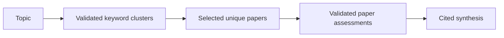

# Catching up with the Crusoe pipeline

Crusoe is a sequence of research stages sharing one `PipelineState`. The stages
now make different promises. Discovery controls corpus coverage. Curator assesses
individual papers. Synthesis writes statements across papers. Human review checks
whether those statements are supported by their cited source text.

## From topic to a selected corpus

The CLI loads config and estimates the remaining paid work. Topic decomposition
asks the model for four to six validated keyword clusters. Each has three to five
keywords. A malformed response gets one repair attempt before the stage fails.

Discovery then calls Semantic Scholar directly. The model does not choose these
searches. The generic tool-loop discovery function is a reference alternative and
does not capture results into pipeline state; the orchestrator uses direct search.

Before PR #19, discovery finished one cluster's keywords before moving to the next.
Two searches returning 20 unique papers could fill the default 40-paper cap from
the first cluster. The rest of the topic was never searched.

PR #19 searches keyword one from each cluster, then keyword two from each cluster,
and continues through every configured keyword. It collects candidates before
selecting the final corpus. Selection takes one new paper per cluster per round.
With four disjoint productive clusters and 40 slots, each contributes ten papers.
Sparse clusters surrender unused slots. Shared paper IDs consume one global slot.
Cluster order breaks ties for remainder slots.

This increases retrieval effort. Four three-keyword clusters make 12 logical API
searches at 20 results each. The 40-paper cap limits downstream work, not those
240 requested result slots. Duplicate and empty slots still cost retrieval effort.
`_discovery_sources` keeps every observed cluster/query pair for selected papers.
`_source_cluster` remains the first source for compatibility. Provenance survives
curation and checkpoints; the spreadsheet does not currently display these fields.

Balanced retrieval addresses omitted subtopics. It does not establish better
relevance. The PR includes a fixed-budget scorer, but the real-topic comparison
with independently curated relevance judgments has not been run.

## From individual papers to a synthesis

Curator assesses papers in batches of eight. It validates relevance, confidence,
methodology, contribution type, and a short interpretation. One schema repair is
allowed per batch. Failed assessments stay visible with an explicit failure status.

Reading priority is computed deterministically: 60% normalized relevance, 15% model
confidence, 15% citation percentile, and 10% recency percentile. Discovery order
breaks equal-score ties. Model confidence is a judgment, not a calibrated probability.

Synthesis uses only successfully assessed papers. Up to 20 eligible papers use a
single final-generation call. Larger corpora use map batches and a reducer. Each
map summarizes one batch into validated evidence-bearing findings. The reducer
combines those findings with their source evidence. The implementation supports
up to 80 eligible papers.

The model receives compact records. Abstract whitespace is normalized and excerpts
are capped at 1,200 characters, preferring a sentence boundary after character 800.
The reducer receives source excerpts separately from curator-generated assessments.
A curator summary is an interpretation, not a source quotation.

The newer synthesis contract retains the old summary/theme/gap/future-work fields
for compatibility. Its `landscape` adds cited themes, gaps, future work, methodology
patterns, disagreements, and shared limitations. Validation rejects unknown paper
IDs, failed-curator sources, invented reading-list titles, and reducer citations
outside validated map evidence. These checks establish reference integrity. They
do not establish that a cited abstract entails a statement.

## The next change: issue #18

PR #20 did not exist when this work began. The issue #18 implementation is the
new work on `feature-18-claim-evidence-review`; its eventual PR number is assigned
by GitHub. The concrete behavior is an offline claim-review command.

The reviewer reads each cited landscape statement beside its papers' stored
abstracts and marks it supported, unsupported, or uncertain. It displays full
abstracts, which can contain more text than the model saw. Those are cited source
contexts, not automatically selected supporting quotations. Missing evidence is
explicit. Model confidence and human judgment remain separate.

Review artifacts include the claims, citations, abstracts, and current human labels.
Their fingerprint prevents feedback from moving silently to a changed claim or
changed source. Confirmed decisions save immediately and resume skips completed
items. The reviewer does not rewrite the synthesis, call a model, or automatically
apply feedback to another run. That makes it a human evaluation loop first.

The persisted feedback is outside generated spreadsheets. This avoids overwriting
human labels during a later export. See [CLAIM_REVIEW.md](CLAIM_REVIEW.md) for usage,
the judgment policy, and the precise scope of covered statements.

## Export and request budgets

The output projector converts state into one canonical workbook: Summary, Papers,
Themes, Gaps, Future Work, Methods, Disagreements, and Reading Order. XLSX and Google
Sheets consume the same representation. XLSX is the default and needs no Google
OAuth. The XLSX writer already uses temporary-file replacement.

With the default 40-paper profile, the clean LLM plan is nine requests: one
decomposition, five curator batches, two synthesis maps, and one reducer. If every
semantic response needs its one allowed repair, the ceiling is eighteen before
transport retries. A configured physical-request budget counts attempts before
they are sent. SDK retries are disabled. A 429 is never retried; one 503 retry can
be enabled. Discovery's API searches are outside this LLM request budget. Human
claim review uses no API requests.

## What issue #15 still needs to fix

Synthesis already has a stronger recovery contract than the earlier stages.
Its manifest fingerprints the topic, ordered compact evidence, batch plan,
prompt/contract versions, and provider/model/generation settings. Validated map
batches save as they complete. Resume reuses matching valid work and credits it
in the request estimate. A matching but corrupt artifact fails explicitly. A
stale fingerprint causes recomputation.

Discovery and curator currently commit their outputs at stage boundaries. Their
successful partial queries or assessments are not yet durable. The orchestrator
mostly considers their stages complete when the corresponding output is nonempty.
This is weaker than proving that the outputs match today's topic and settings.

`PipelineState.save()` still writes JSON directly to one configured checkpoint
path. A process interruption can corrupt it, and the default shared path is unsafe
for independent simultaneous research sessions. Issue #15 calls for atomic saves,
run isolation, and stronger concurrency ownership, then reusable curator and
discovery work. It also calls for an explicit untrusted-data prompt boundary.

Export recovery has another gap: matching success metadata can suppress writing
even after someone deletes the workbook. Issue #15 requires checking the local
artifact before skipping. The new review workflow avoids those persistence paths
but does not repair them for the rest of the pipeline.

The documented reason for synthesis caching is to avoid paying again for identical
validated work. Applying content identity to human judgments is a design extension
of that rule: a human's work should not be lost or attached to different evidence.
It is not a claim that the wider recovery problems are already solved.

## Source map

- Entry and sequencing: `scripts/run_pipeline.py`, `src/agents/orchestrator.py`.
- Selected corpus and provenance: `src/agents/discovery.py`, PR #19 commit `a813c63`.
- Paper assessment and ranking: `src/agents/paper_curator.py`.
- Evidence contract and cached maps: `src/agents/synthesis.py`, commits `a328e27` and `bb03441`.
- Workbook projection and writers: `src/output/projector.py`, `src/output/xlsx.py`, `src/output/google_sheets.py`.
- Human inspection and artifact ownership: `scripts/review_claims.py`, `src/evaluation/claim_review.py`.

This explanation is grounded in source, those commits, the issue descriptions,
`docs/SYNTHESIS_EVALUATION.md`, and `tradeoffs.md`. The historical reasons above are
documented there. No measured real-world relevance gain is inferred from offline
test success.
