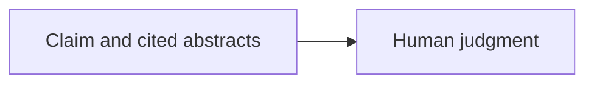
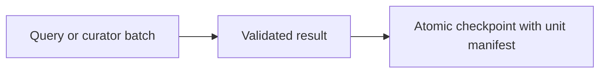

# Recovery changes and tomorrow's handoff

PR #20 protects the human work of reviewing a synthesis. Issue #15 protects the
API work used to produce it. Both bind saved work to its inputs and preserve the
last valid file. Pipeline recovery also has to invalidate dependent stages.

## Human review in PR #20

A valid citation ID does not establish that an abstract supports a statement.
The reviewer displays the statement beside its cited full stored abstracts. You
mark supported, unsupported, or uncertain. Model confidence remains separate.



The judgment belongs to that exact evidence snapshot. A changed claim or cited
abstract must not inherit an unrelated supported label.


Review saves after each confirmed choice, resumes unreviewed items, and makes no
API calls. Full stored abstracts may include text beyond the 1,200-character
excerpts synthesis saw. They are source context, not automatically aligned quotes.

## Paid work in issue #15

Previously curator accumulated assessments in memory until the stage ended.
If a later provider call failed, earlier successful batches were lost. Discovery
had the same stage-level recovery gap for searches.


Now each successful unit is recorded before starting the next one. Curator caches
only strictly validated, complete assessments for its batch. Discovery caches
successful responses in service order, including empty results. Failed queries
and failed schema batches remain pending for retry on resume.



Resume checks the manifest and result checksums, then reuses compatible units.
It reconstructs balanced discovery/provenance and ranks the entire curated corpus.
It does not reuse a partial ranking as a final result.


Curator identity includes the exact ordered compact request records, original
source records, topic, batch plan, explicit contract version, schema, prompts,
and provider/model/temperature identity. Source metadata is included conservatively
because it is copied into the public curated output. Credentials and file paths
are excluded. Discovery identity includes clusters, query order, topic, fetch limit,
selection cap, API fields, and its contract version.

Stale identity causes recomputation. Invalid current artifacts and checksum failures
raise errors before reuse or budget credit. Changing discovery identity clears
dependent curated and synthesis results. Changing curator identity clears synthesis
and its work. This is why a nonempty old synthesis cannot suppress the new work.
The request estimator applies the same validation/invalidation to a copy of state,
so planning does not change the checkpoint.

If discovery is still pending, its selected corpus is not yet known. Planning stays
conservative about curator costs. Saved curator units remain candidates until the
corpus is reconstructed, then matching units can be reused. A failed search does
not by itself discard paid assessments that might still belong to the same inputs.

The curator system prompt now explicitly treats titles, abstracts, metadata,
embedded instructions, topic text, and validation diagnostics as untrusted data.
The same system boundary applies during repair. Tests verify the actual emitted
messages and strict response acceptance. They do not prove a live model is immune
to prompt injection.

## What survives an interruption

The tests demonstrate five papers split into batches `[p0,p1]`, `[p2,p3]`, `[p4]`.
After two saved successes, a provider failure interrupts the third. The checkpoint
contains the first two validated batches. Resume sends only `[p4]`. Its clean plan
counts one remaining curator call plus synthesis, rather than charging all three
curator batches. A crash after the last batch save but before publication can
reassemble the public result without another provider call.

A discovery test saves an empty query and one query finding a shared paper, then
interrupts before the next response. Resume skips exactly those successful queries,
runs the remaining four, and reconstructs all observed cluster/query provenance.
A full partial corpus does not mark pending queries complete.

There is still a window between an external service completing a call and the
validated result reaching disk. A crash in that window may repeat the call. This
implementation guarantees reuse of durably saved valid work, not exactly-once
execution across a remote API and local filesystem.

## Run directories, atomic files, and ownership

```bash
python scripts/run_pipeline.py --topic "authentication tokens" --run-dir data/runs/my-run
python scripts/run_pipeline.py --resume --run-dir data/runs/my-run
python scripts/review_claims.py data/runs/my-run/checkpoint.json --reviewer Raghav
```

Without `--run-dir`, a fresh CLI run receives a unique directory under
`pipeline.runs_directory` (`data/runs` by default). Each directory owns
`checkpoint.json`, `crusoe.log`, `outputs/`, and optional review sidecars. The CLI
resolves this before checkpoint preview, request planning, or provider creation.
Use the printed run path when resuming; no ambiguous global latest-run pointer is
maintained. A fresh invocation refuses to overwrite an existing run/checkpoint.

`PipelineState.save()` writes a sibling temporary file, flushes/fsyncs it, and
atomically replaces the old checkpoint. Serialization or replacement failure
preserves the prior file. This protects against torn process-level writes; it is
not a transactional database or a guarantee against every power/storage failure.

The orchestrator holds an exclusive `<checkpoint>.lock` through load, research,
and export. Normal errors and Ctrl+C release it. A killed process may leave its
lock behind. Verify that its owner stopped before manually deleting that exact
lock. Automatic stale-lock stealing is deliberately excluded. Independent runs
are isolated; concurrent mutation of one run is rejected.

The CLI's run-local XLSX directory overrides the configured legacy XLSX directory.
Library callers that explicitly supply a checkpoint/output path retain ownership
of those paths and must choose separate destinations for independent sessions.
Full checkpoint rewrites increase I/O as cached query responses accumulate.

## Legacy checkpoints and export repair

```bash
python scripts/run_pipeline.py --resume --checkpoint data/session_checkpoint.json
```

Existing `pipeline.checkpoint_path` configurations and direct library callers remain
supported. New state fields have empty defaults. A completed legacy stage without
a manifest remains loadable, but its original inputs cannot be retrospectively
verified. Start a new isolated run when those identity guarantees are required.

XLSX success records now include the actual file's SHA-256. Resume requires that
file to match as well as the destination and projected workbook fingerprint.
Deletion or modification triggers export only; already completed research need
not call a provider. Historic export records without a file hash are rewritten
once to establish it. Google Sheets remote contents are not read back or hashed.

Human labels remain in separate review files, so rebuilding an XLSX cannot erase
them. Changed synthesis/evidence still causes PR #20's stale-review rejection.

## Suggested commit message

Verification: the final local offline suite passed **223 tests**, with **3 opt-in
live tests skipped**. The 27 recovery-focused tests also passed. Documentation
links and `git diff --check` passed. Tests used the existing `.venv` interpreter,
Python 3.10.2; the declared Conda Python 3.11 environment was not available for this
verification run. No live provider quota was spent.

```text
Make pipeline recovery resumable and durable
```

## Draft PR description

Discovery queries and curator batches previously lost completed work when a later
call failed. Checkpoint writes could tear, independent sessions shared default
storage, and resume could skip a deleted workbook.

Persist validated query/batch manifests with content identities and checksums,
reuse saved units on resume, and credit cached curator calls in request estimates.
Invalidate dependent outputs when inputs change. Add an explicit untrusted-data
boundary to initial and repair curator prompts.

Write checkpoints atomically, isolate CLI runs and exports in per-run directories,
and exclude concurrent writers to one checkpoint. Verify local XLSX byte hashes
before skipping export, regenerating missing or modified files. Preserve explicit
legacy checkpoints and keep human-review artifacts separate.

Validation covers interrupted query/batch reuse, stale and malformed artifacts,
request-estimate credits, failed atomic replacement, process-level lock exclusion,
key-free export-only CLI resume, and XLSX read-back after deletion or tampering.
The default suite is offline. Live prompt-injection robustness and Google Sheets
remote drift are not established by these tests.

Addresses #15. Builds on PR #20 without changing synthesis generation or human
judgment semantics.
